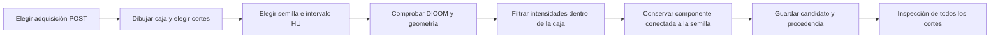

# Máscaras POST: guía del primer algoritmo de Axivol

Esta guía explica cómo obtener una **máscara candidata en la tomografía posterior a TACE**, cómo se calcula y qué falta para evaluarla científicamente. La salida se identifica como **Candidate · Unreviewed**: una región propuesta por el algoritmo, todavía sin revisión experta. No es una referencia clínica ni una medida de respuesta al tratamiento.

El método es semiautomático: una persona elige una región, una semilla y un intervalo de intensidades; el programa conserva los vóxeles conectados que cumplen esas condiciones. **No utiliza una red neuronal entrenada ni traslada la máscara PRE a POST.**

Para comenzar, lee las secciones 1–4. Para seguir el código, continúa con las secciones 5–7. La derivación, ejemplos resueltos y definición de las métricas están en [Matemáticas del algoritmo](post-segmentation-math.md).

## 1. Qué estamos construyendo

### La pregunta de esta etapa

¿Podemos construir una herramienta reproducible que, a partir de una adquisición POST y de una selección humana explícita, genere una región tridimensional candidata, conserve su procedencia y permita inspeccionarla?

La unidad de trabajo es **una región objetivo dentro de una adquisición de un estudio de un paciente**. La pregunta sobre su exactitud anatómica se podrá responder cuando exista una referencia POST independiente. La pregunta sobre utilidad clínica exige además otro diseño de evaluación.

| Concepto | Significado en esta implementación |
| --- | --- |
| TC o CT | Tomografía computarizada: imágenes y metadatos DICOM. |
| PRE | Estudio anterior al tratamiento. |
| POST o follow-up | Estudio posterior. La cronología no verifica por sí sola la fase de contraste ni la correspondencia de una lesión. |
| Vóxel | Elemento de una imagen tridimensional, con una posición y un tamaño físico. |
| Máscara binaria | Una matriz de `True` y `False`: cada vóxel pertenece o no pertenece a la región. |
| ROI | Región de interés: aquí, una caja tridimensional que limita dónde buscar. |
| Semilla | Un vóxel elegido por la persona dentro de la región que desea explorar. |
| HU | Unidades Hounsfield: valores de atenuación de la TC, calculados a partir de sus píxeles y metadatos. |
| Candidato | Resultado del algoritmo, pendiente de revisión. |
| Referencia experta | Delimitación obtenida con un protocolo de anotación y revisión, independiente del candidato que se evaluará. |

### Lesión completa y tejido viable son objetivos distintos

La meta de desarrollo es facilitar la delimitación de una lesión objetivo en POST. **El resultado actual es solamente una región conectada seleccionada por intensidad**: no se puede afirmar que represente la lesión completa, una zona tratada o su componente viable.

Antes de construir las referencias, un experto debe fijar qué estructura se delimitará y cómo tratará necrosis, depósitos de material, vasos, márgenes poco visibles y otras zonas ambiguas. Esa definición debe mantenerse igual entre anotadores y métodos. La viabilidad exige una interpretación de las imágenes y del realce; una zona brillante o un determinado rango HU no bastan para establecerla.

Por eso, el metadato `target` declara que el objetivo anatómico sigue sin verificarse. El volumen mostrado es **el volumen de la región candidata**. El sistema no calcula reducción tumoral, porcentaje de respuesta ni categorías de respuesta al tratamiento.

## 2. Qué contiene HCC-TACE-Seg y qué falta

El artículo de Moawad y colaboradores describe imágenes antes y después de TACE, 105 objetos DICOM SEG correspondientes a imágenes **PRE** y una tabla con mediciones radiológicas de ambos momentos. Las mediciones tabulares POST no son máscaras tridimensionales POST. La distinción se encuentra en las secciones *Data processing and curation* y *Data Records* del artículo [1].

La colección se diseñó, entre otros usos, para desarrollar segmentación y predicción a partir de imágenes previas al procedimiento. Ese objetivo es coherente con su enfoque en PRE; **el artículo no declara una causa específica por la que no se generaron máscaras POST equivalentes**. No debemos atribuir la omisión a falta de tiempo, imposibilidad técnica o una decisión clínica que los autores no reportan.

Para Axivol, la referencia POST queda pendiente porque no contamos con una delimitación POST independiente y revisada del objetivo que queremos medir. Generar un candidato no resuelve automáticamente esa falta de referencia.

### Reconstrucción del método publicado: alcance A–K

Esta reconstrucción corresponde al artículo del dataset, **no al algoritmo nuevo de Axivol**. Se separa lo reportado de lo que falta para repetirlo.

| Apartado | Evidencia y límite |
| --- | --- |
| **A. Material revisado** | Texto completo de PMC9849450, especialmente métodos, registros y validación técnica. No se inspeccionó el trabajo original de cada anotador. |
| **B. Diseño** | Colección retrospectiva de una institución. No es un ensayo de nuestro algoritmo POST. |
| **C. Lógica del método** | Preparar imágenes PRE y anotaciones revisadas para investigación de segmentación y predicción. |
| **D. Cadena** | Selección de casos → preparación de imágenes PRE → anotaciones → revisión → consenso → conversión y control de archivos. |
| **E. Datos y elegibilidad** | Se reportan 105 pacientes con HCC y estudios antes y después de TACE; se excluyeron pacientes con más de un foco de HCC. Ese total no equivale a 105 casos elegibles para cualquier nuevo experimento. |
| **F. Secuencia reportada** | Las fases PRE se registraron y remuestrearon a la fase portovenosa; tres residentes hicieron anotaciones con herramientas semiautomáticas de AMIRA y un radiólogo experto las revisó. Las tres segmentaciones se combinaron con STAPLE. |
| **G. Herramientas reportadas** | AMIRA; registro afín e interpolación lineal; Convert3D de ITK-SNAP para manipulación y STAPLE; dcmqi en el entorno de 3D Slicer para convertir NIfTI a DICOM SEG. No se reportan aquí versiones ni todos los parámetros operativos. |
| **H. Control de calidad** | El artículo describe revisión experta y comprobaciones con POSDA de correspondencia entre contornos, cortes y referencias DICOM. Esto no valida nuestro método POST. |
| **I. Información faltante para reproducir cada máscara** | Decisiones detalladas de cada anotador, todas las versiones y parámetros de las herramientas, y un protocolo equivalente de anotación POST. No se completan estos huecos con supuestos. |
| **J. Qué se puede repetir** | Obtener los archivos publicados, comprobar sus referencias, superponer cada SEG sobre sus cortes correspondientes y medir la etiqueta elegida con geometría verificada. Rehacer exactamente el consenso original requiere información adicional. |
| **K. Juicio de reproducibilidad** | El flujo publicado es trazable, pero la producción exacta de cada anotación está parcialmente especificada. Nuestro crecimiento por umbral es una línea base nueva; no es una reproducción de AMIRA o STAPLE. |

El artículo también advierte de series con fases mezcladas por problemas de exportación. Seleccionar una serie por nombre o por su posición en una lista no demuestra que todos sus cortes pertenezcan a una adquisición compatible [1].

## 3. Cómo usar la herramienta

### Preparación

Desde la carpeta `hcc-tace-lab`, inicia la versión que incluye el editor:

```bash
docker compose up -d --build app
```

Abre [Axivol](http://127.0.0.1:8770/). Para el caso piloto público puede usarse [HCC_002](http://127.0.0.1:8770/?case=HCC_002), siempre que sus archivos ya se hayan descargado según el [README](../README.md). Esta guía no contiene un resultado de segmentación POST de ese caso.

En **Study details**, elige la serie y adquisición del visor posterior. Comprueba su cobertura y revisa los cortes antes de seleccionar la región. Las fases, la identidad de la lesión y su interpretación siguen requiriendo revisión humana; la selección cronológica automática no las certifica.

El cargador cuantitativo de esta versión admite TC clásica de un cuadro por archivo, monocroma `MONOCHROME2`, de 16 bits, con unidades HU y geometría regular verificables. Rechaza localizadores, adquisiciones multienergía, transformaciones cuantitativas no admitidas y planos desplazados lateralmente que exigirían remuestreo. Que el visor pueda mostrar una imagen no implica que esa adquisición esté admitida para segmentación cuantitativa. Los controles concretos están en `volume.py`.

### Secuencia de trabajo

1. **Abre `Follow-up mask`.** Es el panel de la máscara POST. Verifica que el visor muestra el caso y adquisición que quieres procesar.
2. **Pulsa `Draw region` y arrastra sobre la imagen POST.** El rectángulo establece los límites de filas y columnas. No sigue por sí solo el contorno de la lesión.
3. **Ajusta `First slice` y `Last slice`.** El rectángulo se extiende a lo largo de ese intervalo: forma una caja, no un contorno diferente en cada corte. Revisa que incluya el objetivo sin abarcar innecesariamente estructuras vecinas.
4. **Pulsa `Pick seed` y haz clic dentro de la región objetivo.** Se registra la fila, columna y corte de ese punto. Escoger una semilla en un vaso o fuera de la estructura cambia qué componente se obtiene.
5. **Introduce `Lower HU` y `Upper HU`.** El algoritmo aceptará valores entre esos límites, incluidos los extremos. No existe en esta versión un intervalo HU validado para identificar automáticamente una lesión POST. El punto semilla también debe estar dentro del rango.
6. **Pulsa `Generate candidate`.** El servidor verifica las entradas, procesa el volumen y guarda un candidato nuevo. Repetir con otros parámetros produce otro identificador; no sustituye el resultado anterior.
7. **Inspecciona la superposición con `Show candidate`.** Recorre todos los cortes incluidos y los inmediatamente anteriores y posteriores. Activa y desactiva la máscara para ver el tejido debajo. Revisa entradas en vasos, zonas faltantes y límites rectos que coincidan con la caja.
8. **Consulta las advertencias.** Si la máscara toca alguna cara de la ROI, puede estar recortada o escapándose hacia otra estructura. Amplía la caja solo después de examinarlo: hacerla mayor también puede aumentar una fuga.
9. **Usa `Saved candidates` para comparar intentos.** Compara sus parámetros y su aspecto, no solamente sus volúmenes. Una región mayor no es necesariamente mejor.
10. **Pulsa `Download mask`.** Descarga un ZIP con `mask.npz` y `metadata.json`. Conserva ambos: la matriz sola no explica a qué adquisición pertenece.

La inspección del usuario no convierte automáticamente el estado en aprobado. Esta versión conserva `unreviewed`; todavía no implementa una adjudicación clínica ni una herramienta de corrección manual voxel a voxel.

### Window y Level no son los umbrales del algoritmo

**Window** y **Level** cambian cómo se ven los grises en pantalla. **Lower HU** y **Upper HU** determinan qué vóxeles pueden entrar en la máscara. El algoritmo trabaja con valores HU del DICOM, no con los valores de gris de una captura PNG.

Cambiar únicamente Window y Level debe mantener el candidato y su volumen. Cambiar el intervalo HU requiere generar otro candidato.

## 4. Qué decisiones toma la persona y cuáles toma el programa



La persona decide **dónde buscar y qué intensidades admitir**. El programa decide qué vóxeles admisibles tienen un camino hasta la semilla. No reconoce por nombre hígado, tumor, necrosis o lipiodol.

La conectividad es de **seis vecinos**: dos vóxeles se conectan si comparten una cara. Tocarse solamente por una arista o esquina no es suficiente. En la implementación se etiquetan las componentes de todos los vóxeles admisibles de la caja y se conserva la etiqueta que contiene la semilla. Esto produce el mismo conjunto que recorrer esos seis vecinos desde la semilla; no implica entrenar un modelo [2, 3].

No se rellena automáticamente el interior de la lesión ni se suavizan sus límites. Una zona que no cumple el rango HU puede quedar fuera aunque visualmente parezca formar parte del objetivo. Es un comportamiento del método, no una confirmación anatómica.

## 5. Cómo seguir el código

Los componentes se mantienen separados para poder comprobar los errores donde se originan.

| Archivo | Qué hace | Qué conviene leer |
| --- | --- | --- |
| [`hcclab/geometry.py`](../hcclab/geometry.py) | Define cortes y pilas; ordena y comprueba relaciones espaciales; calcula volumen físico. | `Slice`, `build_stack`, `native_volume_cm3`. |
| [`hcclab/volume.py`](../hcclab/volume.py) | Carga los píxeles de una adquisición como volumen HU y distingue el padding de los datos válidos. | `load_hu_volume`. |
| [`hcclab/segmentation.py`](../hcclab/segmentation.py) | Aplica ROI, rango HU y componente conexa. No conoce casos ni rutas de archivos. | `grow_region`. |
| [`hcclab/candidates.py`](../hcclab/candidates.py) | Guarda candidatos inmutables, comprueba integridad y prepara la exportación. | `CandidateStore`, `stack_identity`. |
| [`hcclab/lab.py`](../hcclab/lab.py) | Une selección de caso, adquisición, algoritmo, medición y procedencia. | `post_stack`, `create_candidate`, `candidate_for_stack`. |
| [`hcclab/server.py`](../hcclab/server.py) | Recibe peticiones HTTP y devuelve datos, imágenes o archivos. | Las rutas de candidatos y sus validaciones. |
| [`web/app.js`](../web/app.js) | Convierte las selecciones de pantalla en índices y presenta candidatos y advertencias. | Editor de región, semilla y parámetros. |

### `grow_region`, explicado paso a paso

1. **Comprueba el volumen.** Debe ser una matriz numérica 3D, finita y no vacía. Se rechazan `NaN`, infinitos y tamaños fuera de los límites de procesamiento.
2. **Comprueba índices y ROI.** Se requieren enteros, una caja no vacía dentro del volumen y una semilla dentro de ella. No se redondean coordenadas inválidas silenciosamente.
3. **Comprueba intensidades.** Los límites deben ser finitos y `lower_hu <= upper_hu`. Si la semilla no cumple el intervalo o está en padding, se devuelve un error; no se busca otra semilla automáticamente.
4. **Recorta una vista de la ROI.** Así, la búsqueda de componentes no necesita etiquetar toda la adquisición.
5. **Construye `admissible`.** Marca los vóxeles dentro del intervalo HU y con píxeles válidos.
6. **Etiqueta componentes.** `ndimage.generate_binary_structure(3, 1)` fija conectividad por caras; `ndimage.label` asigna una etiqueta distinta a cada componente.
7. **Conserva la componente de la semilla.** La semilla global se transforma en índice local restando el inicio de la ROI.
8. **Devuelve una máscara del tamaño original.** Fuera de la caja todos los valores son falsos. No cambia la rejilla ni interpola la imagen.
9. **Calcula diagnósticos.** Cuenta vóxeles, obtiene una caja mínima del candidato y detecta caras de la ROI tocadas.

La caja del resultado, `diagnostics.bounds`, es distinta de la caja de búsqueda, `parameters.roi`. `roi_fraction` indica qué fracción de la caja quedó ocupada; **no es una probabilidad de acierto ni un porcentaje de tumor**.

Los límites de tamaño actuales están declarados en `segmentation.py`: 64 millones de vóxeles para el volumen y 4 millones para la ROI. Son límites de recursos de esta implementación, no criterios clínicos ni tamaños máximos de lesión.

### Errores que deben detener el procesamiento

| Situación | Acción esperada |
| --- | --- |
| La serie no pertenece al estudio de seguimiento seleccionado | Rechazar la petición. |
| Geometría incompleta o incompatible | No inventar espaciamiento ni medir con una geometría sustituta. |
| ROI fuera del volumen o vacía | Pedir una selección válida mediante un error explícito. |
| Semilla fuera de la ROI o del intervalo HU | Rechazar y dejar que la persona corrija la selección. |
| Píxel de padding elegido como semilla | Rechazar; no tratar relleno del archivo como tejido. |
| Candidato de otra adquisición | No superponerlo en la imagen actual. |
| Integridad del archivo guardado incoherente | No exportar una máscara como si sus metadatos fueran válidos. |

## 6. Geometría, procedencia y archivos

### Una máscara pertenece a una rejilla concreta

Dos imágenes con 512 × 512 píxeles pueden representar posiciones y tamaños físicos diferentes. Para interpretar una máscara se necesitan sus referencias DICOM, orientación, posición y espaciamiento. Tampoco se debe asumir que el corte 50 de PRE corresponde al corte 50 de POST.

Los índices internos siguen el orden **`[z, y, x]` = [corte, fila, columna]** y empiezan en cero. La interfaz usa números desde uno. La ROI interna incluye su esquina inicial y excluye la final, igual que los rangos de NumPy. [El documento matemático](post-segmentation-math.md#2-índices-y-región-de-interés) muestra una conversión completa para evitar errores de un corte.

El orden de cortes se determina con su posición proyectada sobre la normal de los planos. La separación entre planos se obtiene de esa geometría; **`SliceThickness` no se usa como sustituto automático de la distancia entre cortes** [4].

### Qué se guarda

Cada ejecución genera una carpeta propia con:

- **`mask.npz`**: matriz binaria `mask` en la rejilla nativa POST.
- **`metadata.json`**: identificador del candidato, estado, parámetros, adquisición, geometría, referencias de cortes, versiones y medida física.

La exportación entrega esos dos archivos dentro de un ZIP. NPZ es un contenedor de matrices NumPy; **no es DICOM SEG ni NIfTI**. Esta etapa no implementa una conversión interoperable ni presupone que 3D Slicer pueda abrir directamente el NPZ con toda su geometría.

| Metadato | Para qué sirve |
| --- | --- |
| `status`, `stage`, `target` | Distinguir el candidato POST sin revisar de una referencia anatómica. |
| `case_id`, `series_uid`, `stack_index`, `acquisition` | Identificar el origen de la región. |
| `parameters` | Conservar semilla, ROI e intervalo HU exactos. |
| `method` | Registrar nombre y versión del algoritmo, conectividad, ausencia de remuestreo y de máscara PRE como entrada. |
| `method.implementation_sha256` | Identificar el contenido de `segmentation.py` y `volume.py` utilizado en la ejecución. |
| `shape_zyx` | Interpretar la forma y orden de ejes de la matriz. |
| `source` | Conservar estudio, marco espacial, orientación, posición y referencias SOP de los cortes. |
| `source.slices[].sha256`, `mask_sha256` | Reconocer el contenido utilizado y comprobar integridad. Un hash no acredita corrección anatómica. |
| `software` | Registrar versiones de NumPy, SciPy y pydicom utilizadas. |
| `voxels`, `volume_cm3` | Contar la región y expresar su volumen físico, sin interpretarlo como respuesta. |
| `diagnostics`, `warnings` | Hacer visibles posibles límites del resultado. |

Para volver a ejecutar exactamente un experimento hay que conservar los archivos de origen correspondientes, los parámetros, las versiones y la revisión del código. Dos ejecuciones con las mismas entradas deben producir la misma matriz binaria; identificadores, fecha y tiempo de ejecución pueden cambiar.

### Dónde quedan los datos en Docker

[`compose.yaml`](../compose.yaml) mantiene dos destinos separados:

| Destino del contenedor | Contenido | Acceso de la aplicación |
| --- | --- | --- |
| `/data` | Descargas y catálogo del dataset. | Solo lectura. |
| `/annotations` | Candidatos generados por Axivol. | Lectura y escritura en un volumen Docker independiente. |

Recrear el contenedor conserva el volumen de anotaciones. Eliminar ese volumen también elimina los candidatos almacenados: exporta los que necesites conservar antes de hacerlo. Ni datos médicos ni anotaciones generadas se incorporan a Git o al contexto de construcción de la imagen.

Con el nombre de proyecto definido en Compose, el volumen se llama `hcc-tace-lab_annotations`. El reporte general conserva el candidato en `post_candidate`, separado de una segmentación POST validada; `post_segmentation_measurement` y `volume_change_percent` permanecen en `null`.

### Leer una exportación con Python

Tras extraer el ZIP, este ejemplo comprueba la consistencia básica. Cambia la ruta por la carpeta extraída. Es una lectura del archivo, no una evaluación de calidad de la segmentación.

```python
from pathlib import Path
import hashlib
import json
import numpy as np

folder = Path("carpeta_del_candidato_extraido")
meta = json.loads((folder / "metadata.json").read_text())
assert hashlib.sha256((folder / "mask.npz").read_bytes()).hexdigest() == meta["mask_sha256"]

with np.load(folder / "mask.npz", allow_pickle=False) as archive:
    mask = archive["mask"]

assert mask.dtype == np.bool_
assert list(mask.shape) == meta["shape_zyx"]
assert int(mask.sum()) == meta["voxels"]
assert meta["status"] == "unreviewed"

print(meta["case_id"], meta["series_uid"], meta["acquisition"])
print(meta["label"], meta["volume_cm3"], "cm³")
```

## 7. Cómo comprobar que funciona

### Pruebas de ingeniería

Desde `hcc-tace-lab`:

```bash
docker compose exec -T app python -m unittest discover -s tests -v
```

Después de descargar el caso público HCC_002, las pruebas que requieren esos archivos se habilitan así:

```bash
docker compose exec -T -e HCC_PILOT_TEST=1 app python -m unittest discover -s tests -v
```

Consulta el resultado real de cada ejecución: una prueba omitida por falta de datos no equivale a una prueba superada. Estos comandos verifican software y relaciones de archivos; no demuestran exactitud clínica POST.

Los comportamientos que deben cubrirse son:

| Comprobación | Qué detecta |
| --- | --- |
| Región sintética con componentes separadas y contacto diagonal | Errores de conectividad o selección de componente. |
| Intensidad exactamente igual al límite inferior o superior | Confusión entre intervalos abiertos y cerrados. |
| ROI de un solo vóxel y límites al borde del volumen | Desplazamientos de índices y errores de límites. |
| `slope` e `intercept` conocidos | Uso de intensidades almacenadas en lugar de HU. |
| Padding, geometría irregular e índices inválidos | Aceptación silenciosa de entradas no compatibles. |
| Volumen sintético con tamaño físico conocido | Errores de unidades y orden de espaciamiento. |
| Guardado, recarga, procedencia y exportación | Pérdida de asociación entre máscara y adquisición. |

La revisión en navegador debe usar ambos visores reales: dibujar y mover cortes, elegir semilla, generar, alternar superposición, cambiar adquisición y volver a abrir un candidato guardado. Debe comprobar también que los controles de cortes siguen respondiendo y que la región se ubica en los píxeles correctos al cambiar el tamaño de la ventana.

### Qué aportan las máscaras PRE a estas pruebas

Las máscaras publicadas permiten comprobar lectura DICOM SEG, referencias SOP, orden espacial, conteo de vóxeles y medición sobre una referencia existente. También permiten explorar el algoritmo en PRE si ese experimento se etiqueta claramente como tal.

**Una prueba PRE no valida segmentación POST.** Después del tratamiento pueden cambiar apariencia, bordes e intensidades. Además, si se obtiene automáticamente la semilla o la ROI de la máscara PRE usada como referencia, el experimento contiene información privilegiada del resultado esperado. Puede servir como comprobación de ingeniería, pero debe declararse y no presentarse como desempeño independiente.

## 8. Cómo evaluaremos la calidad anatómica después

Esta sección es un **plan futuro**, no un resultado disponible ni una función ya implementada.

### Primero, una referencia que no dependa de nuestro candidato

1. Un experto define el objetivo y los criterios de inclusión de tejidos, fase, cobertura y calidad de imagen.
2. Se selecciona un conjunto piloto POST con criterios documentados. Se registran también exclusiones y fallos; no se conservan únicamente ejemplos visualmente favorables.
3. Uno o, preferentemente, más anotadores delimitan el objetivo en las imágenes originales, sin ver la salida de Axivol que se evaluará.
4. Las discrepancias se revisan con una regla de consenso o adjudicación previamente definida. Se conservan anotaciones individuales, revisiones e incertidumbres.
5. La referencia se coloca en la misma rejilla física que el candidato mediante una conversión comprobada. No basta con que las matrices tengan el mismo tamaño.

3D Slicer ofrece herramientas de anotación y edición apropiadas para preparar ese flujo [5]. Sus funciones **Grow from seeds**, **Threshold** e **Islands** no son intercambiables: Grow from seeds no es la misma operación que nuestro componente conexo por umbral. Cualquier edición o remuestreo utilizado debe quedar registrado.

Una máscara producida por Axivol y después corregida puede ser útil para estudiar **edición asistida**, pero no constituye por sí sola una referencia independiente para demostrar que la salida inicial era correcta. Si solo hay un anotador, debe decirse; no se puede afirmar acuerdo entre observadores.

### Separar desarrollo de evaluación

Aunque no entrenemos una red, elegir umbrales, reglas o tamaños de ROI mirando los resultados de todos los pacientes puede ajustar el método al conjunto de prueba.

- Mantener juntos todos los estudios, fases, cortes y lesiones del mismo paciente al separar desarrollo y evaluación.
- Identificar cada lesión a lo largo del tiempo; nunca distribuir sus cortes entre grupos como si fueran pacientes independientes.
- Usar el piloto para aprender y fijar el protocolo de interacción; reservar pacientes distintos para una evaluación posterior.
- Establecer cómo se eligen semilla, ROI y rango HU, cuántos intentos se permiten y qué información puede ver el operador.
- Conservar todos los intentos. No seleccionar retrospectivamente el candidato con mayor Dice en la evaluación.
- Registrar el tiempo humano de selección y revisión separado del tiempo de procesamiento.

No se ha fijado aquí un tamaño de muestra clínico: requerirá definir el objetivo principal, precisión deseada, variabilidad y recursos de anotación. El piloto sirve para detectar problemas, no para declarar eficacia.

### Métricas y lectura de resultados

Compararemos cada candidato con su referencia POST independiente mediante:

- **Dice e IoU:** cuánto coinciden las regiones.
- **HD95 en milímetros:** una medida de discrepancia de bordes, con una convención explícita y reproducible.
- **Diferencia de volumen respecto a la referencia:** sesgo y magnitud del error de segmentación. No es cambio de volumen por tratamiento.
- **Fallos y esfuerzo de revisión:** fugas, truncamientos, objetivos no localizables, intentos inválidos, correcciones y tiempo humano.

Las fórmulas, casos vacíos y límites se explican en [Matemáticas del algoritmo](post-segmentation-math.md#7-evaluación-futura-con-una-referencia-independiente). El trabajo de Taha y Hanbury compara propiedades y limitaciones de estas familias de métricas [6]. Aquí se propone medir distancias en unidades físicas; su artículo contiene también definiciones expresadas en unidades de vóxel, que no deben copiarse sin adaptar la geometría.

Los resultados deberán incluir distribución por caso, fallos y datos excluidos. Si hay varias lesiones o estudios por paciente, el cálculo de incertidumbre debe respetar esa agrupación; no se trata cada corte como una observación independiente. Un buen promedio no demuestra que el método funcione en todos los casos.

## 9. Límites que debemos reconocer al interpretar un candidato

| Límite | Qué puede ocurrir | Cómo documentarlo |
| --- | --- | --- |
| Intensidades parecidas en tejidos distintos | La región puede entrar en parénquima, vasos u otras estructuras. | Registrar la fuga, semilla, ROI e intervalo; revisar todos los cortes. |
| Objetivo heterogéneo | Un rango único puede perder partes del objetivo o unir zonas ajenas. | Identificar qué zonas faltan; no corregirlo cambiando el significado del objetivo. |
| Lipiodol y artefactos | El material y los artefactos pueden cambiar la atenuación y dificultar la delimitación. | Registrar presencia y calidad; no equiparar hiperatenuación con viabilidad. |
| Diferentes fases de contraste | La apariencia de una misma estructura puede cambiar. | Verificar y registrar la fase; no comparar intensidades como si toda adquisición fuera equivalente. |
| Cortes gruesos o efecto de volumen parcial | Un vóxel puede mezclar tejidos y perder detalle de borde. | Conservar espaciamiento y discutir la incertidumbre de delimitación. |
| ROI pequeña | El resultado termina artificialmente en la caja. | Revisar caras tocadas y cortes vecinos. |
| ROI grande | Aumenta la posibilidad de conectar con otra estructura. | Revisar antes de ampliar y conservar los intentos. |
| Conectividad de seis vecinos | Una unión solo diagonal queda separada. | Mantener esa regla explícita y evaluarla antes de cambiarla. |

Un estudio experimental con fantomas documenta que el lipiodol puede producir artefactos de endurecimiento del haz y modificar números CT cerca de la región simulada [7]. Esto sustenta considerar ese problema técnico; **no demuestra** que todos los pacientes del dataset tengan esos artefactos ni que nuestro algoritmo los corrija.

## 10. Recursos y referencias verificadas

Las tres referencias científicas con DOI de esta sección se contrastaron por título, autores y metadatos en **PubMed y Crossref** el 11 de noviembre de 2026. Las páginas técnicas se consultaron en sus sitios oficiales. Las versiones ejecutadas por Axivol se fijan en [`requirements.txt`](../requirements.txt) y se registran en cada candidato; las herramientas citadas como alternativas no se consideran instaladas por el hecho de aparecer aquí.

1. **Moawad, A. W., et al. (2023).** *Multimodality annotated hepatocellular carcinoma data set including pre- and post-TACE with imaging segmentation*. Scientific Data, 10, 33. [Texto completo](https://pmc.ncbi.nlm.nih.gov/articles/PMC9849450/), [DOI: 10.1038/s41597-023-01928-3](https://doi.org/10.1038/s41597-023-01928-3), [PMID: 36653372](https://pubmed.ncbi.nlm.nih.gov/36653372/). **Uso:** distinguir datos PRE, POST, anotaciones, fases y proceso de consenso.
2. **SimpleITK: ConnectedThresholdImageFilter.** [Documentación oficial](https://simpleitk.org/doxygen/latest/html/classitk_1_1simple_1_1ConnectedThresholdImageFilter.html). **Uso:** entender el método clásico de selección por semilla e intervalo; referencia conceptual, no dependencia ejecutada por este baseline.
3. **SciPy: `ndimage.label`.** [Documentación oficial](https://docs.scipy.org/doc/scipy/reference/generated/scipy.ndimage.label.html). **Uso:** operación de componentes conexas utilizada en `grow_region`.
4. **DICOM, Image Plane Module, C.7.6.2.** [Estándar oficial](https://dicom.nema.org/medical/dicom/current/output/chtml/part03/sect_C.7.6.2.html). **Uso:** orientación, posición, orden de Pixel Spacing y diferencia entre espesor y separación.
5. **3D Slicer: Segment Editor.** [Documentación oficial](https://slicer.readthedocs.io/en/latest/user_guide/modules/segmenteditor.html). **Uso:** preparar una futura anotación experta con herramientas identificadas y parámetros registrados.
6. **Taha, A. A., y Hanbury, A. (2015).** *Metrics for evaluating 3D medical image segmentation: analysis, selection, and tool*. BMC Medical Imaging, 15, 29. [Texto completo](https://pmc.ncbi.nlm.nih.gov/articles/PMC4533825/), [DOI: 10.1186/s12880-015-0068-x](https://doi.org/10.1186/s12880-015-0068-x), [PMID: 26263899](https://pubmed.ncbi.nlm.nih.gov/26263899/). **Uso:** métricas de solapamiento, distancias y límites de interpretación.
7. **Ting, Y.-L., et al. (2023).** *Quantitative Assessment of Lipiodol-Related Artifact Reduction for Dual-Energy Computed Tomography After Transcatheter Arterial Chemoembolization: A Phantom Study Evaluating the Use of Metal Artifact Reduction Algorithms*. Journal of Computer Assisted Tomography, 47(5), 704–712. [DOI: 10.1097/RCT.0000000000001477](https://doi.org/10.1097/RCT.0000000000001477), [PMID: 37707399](https://pubmed.ncbi.nlm.nih.gov/37707399/). **Uso:** evidencia experimental de alteraciones técnicas por lipiodol; se revisó el resumen, no un protocolo de corrección aplicado en Axivol.
8. **DICOM, CT Image Module, C.8.2.** [Estándar oficial](https://dicom.nema.org/medical/dicom/current/output/chtml/part03/sect_C.8.2.html). **Uso:** transformación lineal de intensidades y condiciones para establecer unidades HU.

## 11. Qué queda pendiente

- Definición experta del objetivo POST y protocolo de anotación.
- Referencias POST independientes, revisión y adjudicación documentadas.
- Herramientas de corrección e intercambio interoperable, con comprobación de geometría.
- Evaluación sobre pacientes reservados, sensibilidad a parámetros y esfuerzo de revisión.
- Decidir con esos resultados si hacen falta otros métodos; la línea base debe quedar como comparador reproducible.

Ninguno de estos puntos se considera resuelto por obtener una superposición visualmente plausible.
